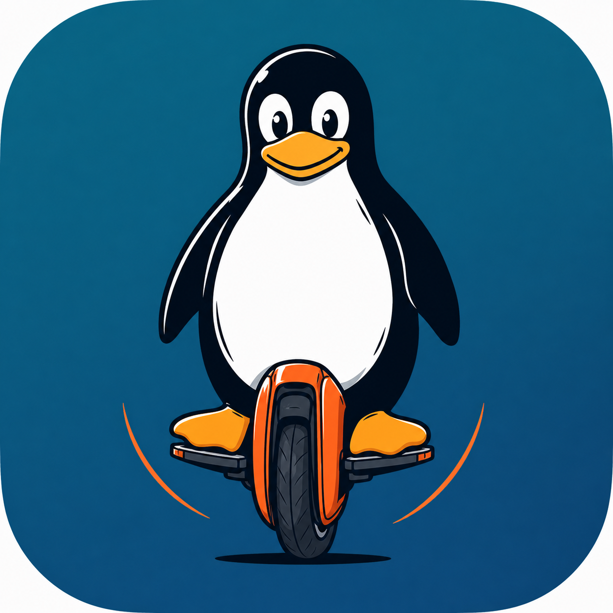

# TuxWheel



[](https://github.com/Tritbool/TuxWheel/actions)
[](LICENSE)

TuxWheel is an Android companion for electric unicycles (EUCs). It connects
over Bluetooth Low Energy (BLE) to display
telemetry, configure supported wheel settings, and record rides.

[Releases](https://github.com/Tritbool/TuxWheel/releases) ·
[Builds](https://github.com/Tritbool/TuxWheel/actions) ·
[Issues](https://github.com/Tritbool/TuxWheel/issues)

## PRIVACY
**This application works offline. It is designed for DeGoogled Android devices and focuses on providing a dashboard for EUCs without bloatware features, focusing on privacy and effectiveness.**

- NO GPS data
- NO Trackers
- NO ads
- NO data collection

## Requirements and wheel support

- Android 6.0 or newer (API 23), with BLE hardware and Bluetooth enabled.
- Wheel-family presentations: KingSong, Gotway/Begode, Veteran, InMotion
  (including V2), and Ninebot/Ninebot Z.
- Actual connectivity, telemetry, settings, and commands depend on
  EUC_BLE_LIBRARY support, the wheel model, and its firmware.
- Smart BMS details are available only for supported wheels/packs.
  A family-specific screen is not a guarantee that every model supports every feature.

## Features

- Customizable dashboard blocks and gauges, with Original and AJDM themes.
- Speed, battery, temperature, current, PWM, and other available telemetry.
- Configurable alarms and charts; optional trips and events pages.
- Smart BMS presentation with per-pack measurements and cell details when available.
- CSV ride logging through a foreground service, plus optional raw BLE diagnostics.
- Picture-in-picture (PiP) on supported Android versions.
- Configurable speed/distance and temperature units.

## Connect to a wheel

1. Enable Bluetooth and open the scan dialog.
2. Grant **Nearby devices** permissions on Android 12+.
   Older Android versions require location permission for BLE scanning;
   enable system location when required.
3. Wait for nearby devices. Scanning stops after **10 seconds**;
   discovered results remain selectable. **Back** cancels the dialog and scan.
4. Tap a device to connect, or enter its Bluetooth MAC address manually.
5. Long-press a discovered device to open the protocol picker.
   Select a specific protocol to force it only when the wheel requires it;
   **Automatic** leaves detection to the library and is the fallback when unsure.

If connection fails, check permissions, Bluetooth, and whether another app
already holds the wheel connection. Report the model, firmware, and selected
protocol with any issue; do not assume all devices in a scan are EUCs.

## Dashboard and pages

Swipe between the dashboard, wheel settings, and enabled optional pages.
Enable charts, trips, and events in the page settings as needed.
Smart BMS visibility and detail depend on the connected wheel.

- **Long-press a dashboard block** to choose its replacement.
- **Single tap** triggers the horn only when that gesture is enabled.
- **Double tap** toggles lights only when the wheel supports the command.
- Choose Original/AJDM styling and units in settings.

Wheel settings and actions are capability-dependent. Verify changes while
stationary; app alarms do not replace the wheel's own safety protections.

## Logging, trips, and diagnostics

The app allows the logging of:
1. Standard data log (similar to WheelLog)
2. SMART BMS Data at detailed level (for battery analysis, later added into euc soh analyzer APP)
3. RAW BLE Frames (similar to WheelLog)

Start CSV logging from the app. The foreground service keeps recording while
the interface is in the background and exposes logging controls in its notification.
Grant notification permission on Android versions that request it.

New files are saved under **Downloads/TuxWheel**. Existing CSV logs remain
available to the trips page.
Storage access follows the Android version's permission and storage rules.

Enable the trips page to inspect recorded ride statistics, share a CSV through
Android's share chooser, or delete a trip after confirmation.
Raw BLE logging is a separate diagnostic option, not a substitute for ride CSVs.

Before sharing CSVs or diagnostic logs, inspect and sanitize them:
remove MAC addresses, device names, location/route data, and other identifiers.
Attach only the relevant, sanitized excerpt to a bug report.

## EUC_BLE_LIBRARY integration

BLE is provided by [EUC_BLE_LIBRARY](https://github.com/Tritbool/euc_ble_library),
not by wheel protocol decoders embedded in this app.
The dependency is `io.github.tritbool:euc-ble-library:0.1.0`;
its version is pinned in `gradle/libs.versions.toml`.

The library owns discovery/scanning, connections, protocol detection/decoding,
and BLE transport. The app's `BleSessionViewModel` wraps library callbacks
into `StateFlow<BleSessionState>` for the UI and other consumers.
It is an **app-wide Koin `single`**, shared by activities, Compose, and services;
resolve it with `inject()`/`koinInject()`, not an Activity-scoped `koinViewModel()`.

Telemetry comes from `EUCData`; BMS details use `getBMSData()` per pack.
Commands must respect the active protocol's capabilities.
The app owns permission prompts, presentation, alarms, storage, and logging.

## UI architecture

Production pages, the pager, and scan content are Compose-only.
Native headers, dialogs, PiP, and the MPAndroidChart chart still use View
interoperability; view binding remains necessary for those integrations.
Compose rendering does not own BLE connections or foreground logging.

Architecture decisions:
[Compose-first dashboard](docs/adr/001-compose-first-dashboard.md) ·
[Koin DI](docs/adr/002-koin-di.md)

## Development

Use Android Studio/SDK tooling and the checked-in Gradle wrapper.
Java/Kotlin compilation targets **JDK 17**; the checked-in
`gradle/gradle-daemon-jvm.properties` selects **JDK 25** for the Gradle daemon
and may download it if it is not installed.
The app currently uses **compileSdk 37** and **targetSdk 36**.

```sh
git clone https://github.com/Tritbool/TuxWheel.git
cd TuxWheel
./gradlew :app:assembleDebug :app:assembleRelease :app:testDebugUnitTest :app:lintDebug
```

These tasks require working resolution of the configured Gradle plugins and
dependencies from Google Maven, Maven Central, the Gradle Plugin Portal and
JitPack (MPAndroidChart). Local Maven artifacts are intentionally not used:
a clean checkout must resolve the published BLE dependency remotely.
Do not downgrade the pinned library or plugins to bypass resolution failures.

During F-Droid preparation, the local build stopped before compilation because
**AGP 9.2.1** could not be resolved. Build, unit-test and lint results for these
changes therefore remain unverified; the existing `0.0.1` GitHub release build
succeeded, but does not validate these changes.

The application ID and Android namespace are `io.github.tuxwheel`
(`io.github.tuxwheel.debug` for debug builds).

## F-Droid preparation and submission

TuxWheel is being prepared for F-Droid; it is **not yet listed**.
This follows the English/French Fastlane layout used in
[EUC SoH](https://github.com/Tritbool/euc_soh_kotlin).
See the [submission guide](https://f-droid.org/fr/docs/Submitting_to_F-Droid_Quick_Start_Guide/)
and [metadata reference](https://f-droid.org/docs/Build_Metadata_Reference/).

### Store listing

`fastlane/metadata/android/en-US/` is the fallback listing; `fr-FR/` contains
the French translation. Each has a title, short description, HTML full
description and `changelogs/1.txt`, matching the current `versionCode 1`.
The English listing reuses the existing app icon at `images/icon.png`;
other locales can fall back to it. Fastlane itself is not needed.

Keep titles within 50 characters, summaries within 80, full descriptions
within 4,000, and release notes within 500. Add
`changelogs/<versionCode>.txt` in each locale for every release.

### Build and licensing checks before submission

- Run the development tasks above from a clean checkout with no local Maven
  artifacts, then test BLE connection and foreground logging on a real device.
- `:app:assembleRelease` produces
  `app/build/outputs/apk/release/app-release-unsigned.apk` without signing
  credentials. F-Droid can build and sign it independently; the GitHub release
  workflow's signing secrets and the shared debug keystore are not required.
- Build timestamps have been removed from generated code and version labels.
  This removes one source of nondeterminism, but does **not** establish
  byte-for-byte reproducibility. Do not configure upstream binary verification
  until it has been tested with the same toolchain and build inputs.
- The unused Samsung Accessory SDK JARs have been removed. Do not reintroduce
  proprietary SDKs or prebuilt libraries without corresponding freely licensed
  source. The Gradle wrapper JAR is build tooling, not an app dependency.
- Review the complete release dependency graph and retain required license
  notices. The GPL-3.0 project license does not replace third-party licenses.
  Include the pinned EUC BLE library's source/license and MPAndroidChart's
  Apache-2.0 source at tag `v3.1.0` in that review. JitPack remains necessary
  for MPAndroidChart; disclose it to F-Droid reviewers rather than adding
  scanner exceptions to hide it.
- Confirm redistributable licenses and attribution for bundled artwork and
  fonts. In particular, `app/src/main/res/font/ajdm.otf` identifies itself as
  Adobe Source Sans Pro under SIL OFL 1.1; retain its copyright and full OFL
  notice. Establish the provenance/license of `prime_regular.otf` (internally
  named Wheellog) and the app icon before claiming the asset audit is complete.
  No generated third-party license inventory is currently provided.

### Release and external submission

1. Finish the licensing checks, add real screenshots below, and verify the
   release build. These are still outstanding; metadata alone is not approval.
2. Publish a **new** release after these changes are merged. The existing
   `0.0.1` tag predates this preparation and will not expose this metadata.
   Increment `versionCode` and `versionName` together, add the matching
   localized changelogs, and tag that exact commit. Do not move an existing tag.
3. In a separate fork of [fdroiddata](https://gitlab.com/fdroid/fdroiddata),
   prepare `metadata/io.github.tuxwheel.yml`: use this repository as `Repo`,
   `RepoType: git`, the confirmed GPL-3.0 license identifier, `subdir: app`,
   `gradle: [yes]`, and the new release tag as the build `commit`. Match the
   release's version name/code and select a build environment supporting the
   checked-in Gradle/JDK/Android SDK requirements. Configure tag-based update
   checks to match the project's release-tag convention.
4. In that fdroiddata checkout, run `fdroid readmeta`, `fdroid rewritemeta
   io.github.tuxwheel`, `fdroid lint io.github.tuxwheel`, and
   `fdroid build --verbose io.github.tuxwheel`. Resolve scanner/build findings
   before opening the metadata merge request. Include the source, issue tracker
   and changelog links, and explicitly state that you are the upstream author.
5. Submit the merge request to fdroiddata, or open a
   [Request for Packaging](https://gitlab.com/fdroid/rfp/-/issues) with the
   source/release links if you need help with packaging.

F-Droid-signed and upstream-signed APKs are not normally interchangeable
updates. Users may need to uninstall one before installing the other;
export any logs/settings they need first.

### Screenshots to provide

Add fresh TuxWheel captures using sanitized/demo data under
`fastlane/metadata/android/en-US/images/phoneScreenshots/1.png`, `2.png`, etc.
Use the equivalent `fr-FR/images/phoneScreenshots/` directory for French captures.
No screenshots have been fabricated or copied from EUC SoH.
Suggested captures:

- `DASHBOARD`: customized blocks and gauge; capture Original and AJDM themes.
- `SCAN`: discovery dialog showing devices and manual MAC entry.
- `PROTOCOL_PICKER`: long-press device menu with Automatic and protocol choices.
- `SMART_BMS`: supported wheel with per-pack measurements and cell details.
- `TRIPS`: recorded ride statistics and share/delete actions.
- `SETTINGS`: wheel-specific controls, page options, themes, and units.

## Contributing and credits

Report reproducible problems in [Issues](https://github.com/Tritbool/TuxWheel/issues).
For changes, describe the affected wheel/features and validation performed.
UI checks and real-wheel testing remain necessary alongside automated tests.

Thanks to [WheelLog](https://github.com/Wheellog/Wheellog.Android), the
[palachzzz fork](https://github.com/palachzzz/WheelLogAndroid), and their contributors.
TuxWheel is licensed under [GNU GPL v3](LICENSE).
